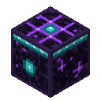

# Doctor Knepper's Dimensional Crafting Table

A crafting table that can use the items in **every chest and barrel you own**, anywhere in the world and in any dimension, plus your ender chest.



## How it works

- Open it like a normal crafting table. The **recipe book** counts your inventory, your ender chest, and every chest and barrel you own, at any distance and in any dimension.
- **Click a recipe** to pull the ingredients into the grid, or shift-click for a full stack. Items in your inventory are used first, then your nearest chests.
- If you switch recipes or close the table without crafting, borrowed items **go back to the chest they came from**. They don't pile up in your inventory.
- Damaged, enchanted or renamed items are never used, the same as vanilla's recipe book.
- Opening the table tells you how many chests it's linked to. Chests in unloaded chunks are loaded for a moment when needed.

## Which chests are yours

- Chests (including trapped and copper chests) and barrels **you place** are yours.
- A chest or barrel with no owner, for example one placed before you installed this mod or found in a structure, becomes yours the **first time you open it**.
- Breaking a chest clears its owner. Nobody can take over a chest that already has one.

## Recipe

| | | |
|:-:|:-:|:-:|
| Obsidian | Eye of Ender | Obsidian |
| Diamond | Crafting Table | Diamond |
| Obsidian | Obsidian | Obsidian |

The recipe unlocks when you pick up an Eye of Ender. Mine the table with any pickaxe.

## Tests

`./gradlew runGameTest` runs the server-side tests. `./gradlew runClientGameTest` opens the game and checks the recipe book end to end. To run the client test on a machine without a GPU (Xvfb + Mesa), set `DIMENSIONAL_CRAFTING_HEADLESS_GL=1`. Mesa's software renderer has no sRGB framebuffers, and that setting turns off the request for one. It only exists in the test code.

## Requirements

- Minecraft **26.3** (Java Edition)
- [Fabric Loader](https://fabricmc.net/use/) 0.20.1 or newer
- [Fabric API](https://modrinth.com/mod/fabric-api)

Install it on both the client and the server.

## Installing

Download `dimensional-crafting-<version>.jar` from the [releases page](https://github.com/DoctorKnepper/Doctor-Kneppers-Dimensional-Crafting/releases), Modrinth or CurseForge, and put it in your `mods` folder along with Fabric API.

## Building from source

You need a Java 25 JDK.

```sh
./gradlew build    # the mod jar ends up in build/libs/
```

## Releasing

Publishing a GitHub release (Releases, then "Draft a new release", with a tag like `v1.0.0`) runs
`.github/workflows/release.yml`. It builds the jar, attaches it to the release and uploads it to Modrinth
and CurseForge. It needs these repository settings (Settings, then "Secrets and variables", then "Actions"):

| Name | Kind | Value |
|---|---|---|
| `MODRINTH_TOKEN` | secret | a Modrinth personal access token with the "Create versions" scope |
| `CURSEFORGE_TOKEN` | secret | a CurseForge API token (from your CurseForge account's API tokens page) |
| `MODRINTH_ID` | variable | the Modrinth project ID |
| `CURSEFORGE_ID` | variable | the CurseForge project ID |

If one platform's values aren't set, the workflow skips that platform. Update `mod_version` in
`gradle.properties` before tagging a new release.

## License

CC0 1.0 (public domain). See [LICENSE](LICENSE).
